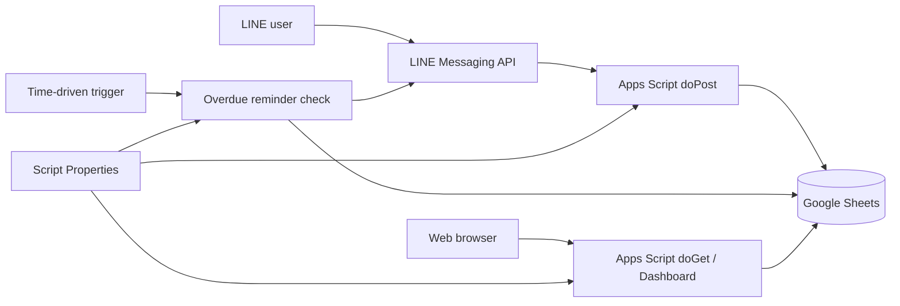

# Architecture

The application separates configuration from source code. `SPREADSHEET_ID`, `CHANNEL_ACCESS_TOKEN`, and other deployment-specific values are stored in Apps Script Script Properties rather than committed to Git.
